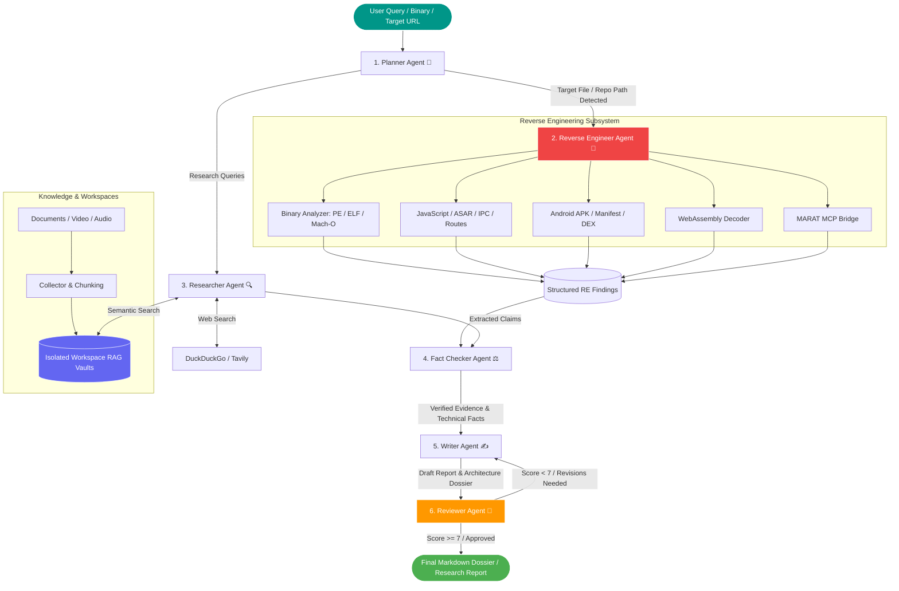

<div align="center">


# 🐾 MARAT
### Multi-Agent Research & Reverse Engineering Platform
*Autonomous cyclic deep-research, full-stack software & binary reverse engineering, isolated MARAT Workspaces, and Model Context Protocol (MCP) tool execution.*  
*Guided by **Mara**, your clever, scholarly red panda companion.*

<br/>

[](https://python.org)
[](https://langchain.com)
[](https://fastapi.tiangolo.com)
[](#-marat-workspaces--document-collector)
[](#-marat-reverse-engineering-suite-mre)
[](https://modelcontextprotocol.io)
[](tests/)
[](LICENSE)

<br/>

[**Overview**](#-overview) • [**Architecture**](#-architecture) • [**Reverse Engineering (MRE)**](#-marat-reverse-engineering-suite-mre) • [**Workspaces Vault**](#-marat-workspaces--document-collector) • [**MCP Hypervisor**](#-model-context-protocol-mcp-hypervisor) • [**Agent Matrix**](#-agent-matrix) • [**CLI Guide**](#-cli-usage) • [**Web Studio & API**](#-web-studio--rest-api)

</div>

---

## 🐾 Overview

**Marat** is an autonomous intelligence, deep research, and software reverse-engineering workstation engineered with proprietary MARAT core technologies:
1. **MARAT Multi-Agent Cyclic Intelligence**: A LangGraph-orchestrated team of autonomous agents driven by **Mara** (our scholar red panda mascot), performing deep multi-step research, Whisper video/lecture transcription RAG, web fact-checking, and peer review.
2. **MARAT Workspaces & Document Vault**: Isolated multi-tenant workspaces, multi-format document ingestion collector (PDF, Markdown, Code, CSV, Text), and an integrated Model Context Protocol (MCP) Hypervisor for dynamic stdio tool execution.
3. **MARAT Reverse Engineering (MRE) Engine**: Pure-Python zero-hallucination static binary and code reverse-engineering suite (PE, ELF, Mach-O, Chromium Electron ASAR archives, Android APKs, WebAssembly WASM, Go buildinfo, and API/IPC boundary extraction) with native extensibility and MCP tool execution.

---

## 📐 Architecture

Marat coordinates an adaptive, cyclic state machine in LangGraph:



---

## 🔬 MARAT Reverse Engineering Suite (MRE)

Marat incorporates a native, high-speed static inspection suite with zero hallucinated telemetry engineered directly into the core platform:

* **Executable & Binary Analyzer (`binary_analyzer.py`)**:
  * Formats: Windows **PE32 / PE32+**, Linux **ELF32 / ELF64**, Apple **Mach-O** (32 & 64-bit), and MS-DOS executables.
  * Extracted metadata: Architecture (x86, x64, ARM, ARM64), entry point, byte size, cryptographic hashes (MD5, SHA1, SHA256).
  * Section table inspection: Section headers, virtual sizes, raw data offsets, and **Shannon entropy** calculation (detecting packed or encrypted sections).
  * String mining: ASCII and UTF-16 string extraction, filtering IPs, URLs, keys, and recognizable symbols.
* **Electron & JavaScript Analyzer (`javascript_analyzer.py`)**:
  * Built-in zero-dependency **ASAR archive unpacker**: Parses Chromium ASAR headers and inventories packaged applications.
  * IPC channel discovery: Scans for `ipcRenderer.send`, `ipcRenderer.invoke`, `ipcMain.handle`, `ipcMain.on`, and `contextBridge.exposeInMainWorld`.
  * API route recovery: Discovers Express, FastAPI, Flask, and standard REST route endpoints (`app.get`, `app.post`, `@router.get`, etc.).
* **Android APK Inspector (`android_analyzer.py`)**:
  * Unpacks `.apk` packages, parses binary XML StringPools to extract permissions and components (`activities`, `services`, `receivers`, `providers`).
  * Scans `classes.dex` headers and catalogues native architecture `.so` libraries (`armeabi-v7a`, `arm64-v8a`, `x86_64`).
* **WebAssembly Decoder (`wasm_analyzer.py`)**:
  * Validates WASM magic headers (`\0asm`) and versions.
  * Decodes section IDs (Type, Import, Function, Table, Memory, Global, Export, Code, Data) with import/export counts.
* **Go Build Information Extractor (`go_analyzer.py`)**:
  * Recovers Go runtime versions, module paths, and dependency hierarchies embedded in compiled binaries.
* **MARAT MCP Tool Bridge (`mcp_bridge.py`)**:
  * Seamless stdio connection to external decompiler and inspection servers when advanced Ghidra / radare2 MCP tools are available.

---

## 📁 MARAT Workspaces & Document Collector

Marat features isolated modular workspaces for true departmental or project privacy:

* **Isolated Vector Stores**: Every workspace maintains its own isolated ChromaDB collection. Documents indexed in "Workspace A" never bleed into queries made in "Workspace B".
* **Multi-Format Document Collector**:
  * Source code (`.py`, `.js`, `.ts`, `.rs`, `.go`, `.cpp`, `.c`, etc.)
  * Markdown and plaintext (`.md`, `.txt`, `.rst`, `.json`, `.yaml`, `.csv`)
  * PDF documents (pure-Python stream-based text extraction)
  * CSV spreadsheet tables with header retention
* **SQLite Metadata Persistence**: Workspaces and document metadata persist reliably in `data/workspaces.db`.

---

## 🔌 Model Context Protocol (MCP) Hypervisor

Marat features a built-in MCP client hypervisor adhering to the JSON-RPC 2.0 specification:
* **Configuration**: Define servers in `configs/mcp_servers.json` (supports stdio servers with environment variables and custom arguments).
* **Live Discovery**: Automatically queries connected servers for available tools, schema descriptions, and argument models.
* **Execution**: Run MCP tools directly from the CLI or via the FastAPI REST API (`/api/mcp/call`).

---

## 👥 Agent Matrix

| Agent | Icon | Role & Primary Responsibility | Output Artifact |
| :--- | :---: | :--- | :--- |
| **Planner** | 🧭 | Decomposes topics or targets into research schedules and sub-questions. | Sub-Question Schedule |
| **Reverse Engineer** | 🔬 | Performs static binary inspection, entropy scans, IPC & API endpoint mapping. | Structured RE Findings Dossier |
| **Researcher** | 🔍 | Executes bounded live web searches and local vector queries in isolated workspaces. | Extracted Claims & Source URLs |
| **Fact Checker** | ⚖️ | Cross-verifies claims against ground-truth files and citations. | `VERIFIED` / `UNVERIFIED` tags |
| **Writer** | ✍️ | Synthesizes polished Markdown research reports or reverse-engineering dossiers. | Structured Report with Citations |
| **Reviewer** | 🧐 | Scores completeness, rigor, and structural integrity; gates revision cycles. | Peer-Review Evaluation (Score 1-10) |

---

## 🚀 Quickstart

### 1. Installation

```bash
# Clone the repository
git clone https://github.com/shivbu22/Marat.git
cd Marat

# Create and activate virtual environment
python -m venv .venv
.\.venv\Scripts\activate    # Windows
source .venv/bin/activate   # Linux/macOS

# Install dependencies
pip install -r requirements.txt
```

### 2. Configure Environment

Copy `.env.example` to `.env`. Marat supports **Ollama**, **LMStudio**, **LocalAI**, **vLLM**, **Groq**, **OpenAI**, **Anthropic**, and **OpenRouter**:

```env
LLM_PROVIDER=ollama
LLM_MODEL=llama3.2:3b
LLM_BASE_URL=http://localhost:11434/v1
LLM_API_KEY=ollama
```

---

## 💻 CLI Usage

The Marat CLI provides commands for research, reverse engineering, workspaces, and MCP tools:

```bash
# Display CLI commands
marat --help

# 1. Reverse-Engineer a file, directory, or binary
marat re ./src
marat re path/to/binary.exe
marat re app.asar --output reports/asar_re.json

# 2. Autonomous Multi-Agent Deep Research
marat research "Applications of WebAssembly in Edge Computing"

# 3. Hybrid Research + Reverse Engineering Target
marat research "Analyze architecture and security posture" --target ./src

# 4. Multimodal Research with Video Lecture Ingestion
marat research "Attention mechanisms" --video "https://www.youtube.com/watch?v=kCc8FmEb1nY"

# 5. Manage MARAT Workspaces
marat workspaces
marat workspaces create "security-audit" --desc "Target analysis vault"
marat workspaces upload <workspace-id> ./whitepaper.pdf

# 6. Model Context Protocol (MCP) Management
marat mcp list
marat mcp test github

# 7. Start the Web Studio & API Server
marat serve --port 8000
```

---

## 🌐 Web Studio & REST API

Launch the combined FastAPI server and interactive single-page dashboard:

```bash
marat serve --port 8000
```
Open **`http://localhost:8000`** in your browser.

The web studio includes 5 integrated tabs:
1. **Research Studio**: Interactive chat with Mara the red panda, real-time agent state visualization, video ingestion, and live Markdown report preview.
2. **Reverse Engineering Lab**: Drag-and-drop file upload for binaries, ASAR, APK, WASM, or source folders. Displays entropy graphs, section tables, extracted strings, Electron IPC channels, and discovered API routes.
3. **Workspaces Vault**: Create isolated workspaces, upload documents (PDF, Code, Markdown, CSV), and search workspace vector stores.
4. **MCP Hypervisor**: Inspect configured MCP servers, view discovered tools, and execute tool calls interactively.
5. **Settings**: Switch LLM providers dynamically (Ollama, LMStudio, OpenAI, Groq, Anthropic), adjust temperature, and tune search parameters.

### Key API Endpoints

* **Health**: `GET /health`
* **Research Job**: `POST /api/research` or `POST /research`
* **Real-Time Stream**: `POST /research/stream`
* **Reverse Engineer File**: `POST /api/reverse-engineer/analyze`
* **Upload & Analyze**: `POST /api/reverse-engineer/upload`
* **Workspaces**: `GET /api/workspaces`, `POST /api/workspaces`, `POST /api/workspaces/{id}/upload`
* **MCP Tools**: `GET /api/mcp/servers`, `GET /api/mcp/tools`, `POST /api/mcp/call`

---

## 🧪 Testing

Marat includes a comprehensive 48-test test suite:

```bash
python -m pytest tests/
```

All 48 tests validate:
* Binary parser (PE, ELF, Mach-O, Shannon entropy, string extraction)
* JavaScript / Electron ASAR & IPC analyzer
* Android APK & Manifest analyzer
* WebAssembly decoder
* Go buildinfo parser
* LangGraph state & node integration
* Workspace manager & document chunker
* ChromaDB isolated vector store
* MCP Hypervisor JSON-RPC stdio execution
* FastAPI endpoints & backward compatibility

---

<div align="center">

Made with ❤️ and guided by **Mara the Red Panda** 🐾  
Licensed under the [MIT License](LICENSE).

</div>
